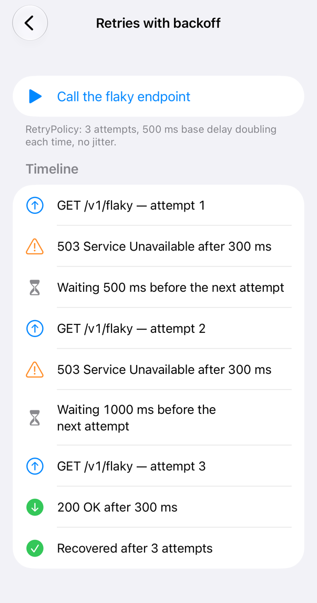
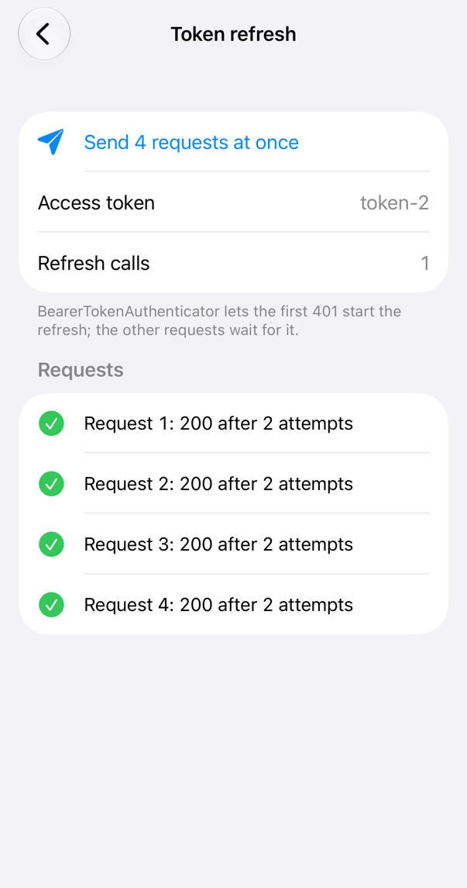
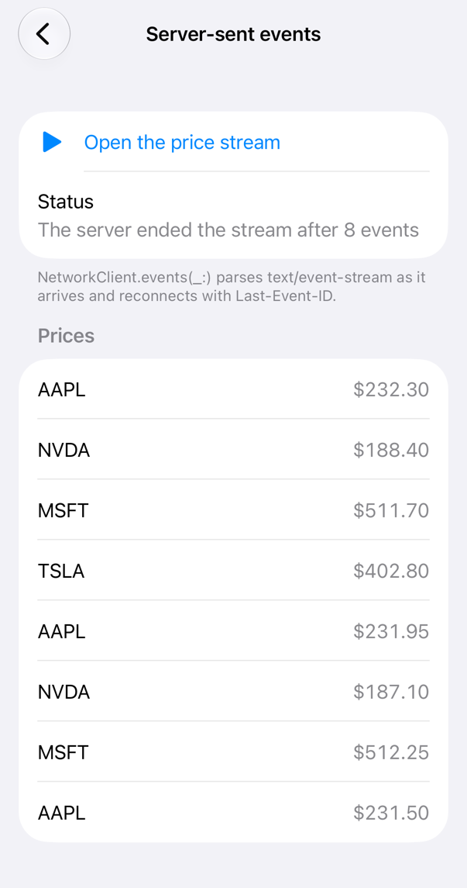
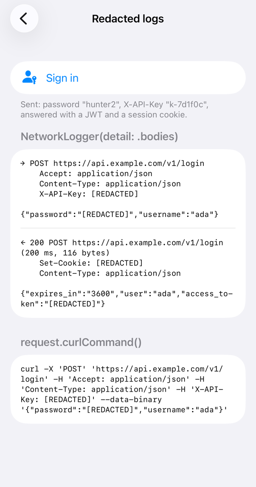

<!-- brand:start -->

<p align="center"><picture><source media="(prefers-color-scheme: dark)" srcset="https://raw.githubusercontent.com/muhittincamdali/iOS-Networking-Architecture-Pro/master/.github/brand/banner-dark.svg"><source media="(prefers-color-scheme: light)" srcset="https://raw.githubusercontent.com/muhittincamdali/iOS-Networking-Architecture-Pro/master/.github/brand/banner-light.svg"></picture></p>

<!-- lang-selector:start -->
<p align="center"><a href="README.md">English</a> · <a href="README.tr.md">Türkçe</a> · <a href="README.zh-CN.md">简体中文</a> · <a href="README.ja.md">日本語</a> · <a href="README.ko.md">한국어</a> · <a href="README.es.md">Español</a> · <a href="README.de.md">Deutsch</a> · <a href="README.fr.md">Français</a> · <a href="README.pt-BR.md">Português (Brasil)</a> · <a href="README.ru.md">Русский</a></p>
<!-- lang-selector:end -->

<p align="center">
<a href="https://github.com/muhittincamdali/iOS-Networking-Architecture-Pro/actions/workflows/ci.yml"></a>
<a href="https://github.com/muhittincamdali/iOS-Networking-Architecture-Pro/releases"><picture><source media="(prefers-color-scheme: dark)" srcset="https://raw.githubusercontent.com/muhittincamdali/iOS-Networking-Architecture-Pro/master/.github/brand/badge-version-dark.svg"><source media="(prefers-color-scheme: light)" srcset="https://raw.githubusercontent.com/muhittincamdali/iOS-Networking-Architecture-Pro/master/.github/brand/badge-version-light.svg"></picture></a>
<a href="https://github.com/muhittincamdali/iOS-Networking-Architecture-Pro/blob/master/Package.swift"><picture><source media="(prefers-color-scheme: dark)" srcset="https://raw.githubusercontent.com/muhittincamdali/iOS-Networking-Architecture-Pro/master/.github/brand/badge-platforms-dark.svg"><source media="(prefers-color-scheme: light)" srcset="https://raw.githubusercontent.com/muhittincamdali/iOS-Networking-Architecture-Pro/master/.github/brand/badge-platforms-light.svg"></picture></a>
<a href="https://github.com/muhittincamdali/iOS-Networking-Architecture-Pro/blob/master/Package.swift"><picture><source media="(prefers-color-scheme: dark)" srcset="https://raw.githubusercontent.com/muhittincamdali/iOS-Networking-Architecture-Pro/master/.github/brand/badge-language-dark.svg"><source media="(prefers-color-scheme: light)" srcset="https://raw.githubusercontent.com/muhittincamdali/iOS-Networking-Architecture-Pro/master/.github/brand/badge-language-light.svg"></picture></a>
<a href="https://github.com/muhittincamdali/iOS-Networking-Architecture-Pro/blob/master/LICENSE"><picture><source media="(prefers-color-scheme: dark)" srcset="https://raw.githubusercontent.com/muhittincamdali/iOS-Networking-Architecture-Pro/master/.github/brand/badge-license-dark.svg"><source media="(prefers-color-scheme: light)" srcset="https://raw.githubusercontent.com/muhittincamdali/iOS-Networking-Architecture-Pro/master/.github/brand/badge-license-light.svg"></picture></a>
</p>

<p align="center">
<a href="#quick-start"><picture><source media="(prefers-color-scheme: dark)" srcset="https://raw.githubusercontent.com/muhittincamdali/iOS-Networking-Architecture-Pro/master/.github/brand/button-start-en-dark.svg"><source media="(prefers-color-scheme: light)" srcset="https://raw.githubusercontent.com/muhittincamdali/iOS-Networking-Architecture-Pro/master/.github/brand/button-start-en-light.svg"></picture></a>
<a href="https://muhittincamdali.github.io/iOS-Networking-Architecture-Pro/documentation/networkingarchitecture/"><picture><source media="(prefers-color-scheme: dark)" srcset="https://raw.githubusercontent.com/muhittincamdali/iOS-Networking-Architecture-Pro/master/.github/brand/button-docs-en-dark.svg"><source media="(prefers-color-scheme: light)" srcset="https://raw.githubusercontent.com/muhittincamdali/iOS-Networking-Architecture-Pro/master/.github/brand/button-docs-en-light.svg"></picture></a>
<a href="https://github.com/muhittincamdali/iOS-Networking-Architecture-Pro/tree/master/Examples"><picture><source media="(prefers-color-scheme: dark)" srcset="https://raw.githubusercontent.com/muhittincamdali/iOS-Networking-Architecture-Pro/master/.github/brand/button-examples-en-dark.svg"><source media="(prefers-color-scheme: light)" srcset="https://raw.githubusercontent.com/muhittincamdali/iOS-Networking-Architecture-Pro/master/.github/brand/button-examples-en-light.svg"></picture></a>
</p>

<!-- brand:end -->

A networking layer for apps on iOS 16+, macOS 13+, tvOS 16+, watchOS 9+ and visionOS 1+, built
on `URLSession` with no dependencies. You describe each call of your API once as a typed
`Endpoint` and send it with a `NetworkClient`; retries, token refresh, caching, logging and
streaming are settings of that client instead of code you write around every request.

## Highlights

- **Typed endpoints** — `Endpoint<User>.get("users/42")` decodes JSON into `User`;
  `Endpoint<Data>` returns the body and `Endpoint<Void>` ignores it. JSON, form and multipart
  bodies, and `PathSegment` for user input in paths.
- **Failures handled once** — a `RetryPolicy` with exponential backoff, jitter and
  `Retry-After`, a `CircuitBreaker`, cache fallbacks when offline, downloads that resume
  where the connection dropped, and one `NetworkError` type that tells an offline device
  from a 404 or a model that no longer matches the JSON.
- **Token refresh done right** — `BearerTokenAuthenticator` refreshes once for all requests
  that got a 401, retries each of them once, and only sends the token to your hosts.
- **Streaming** — server-sent events parsed by the HTML standard's rules, and a WebSocket
  that reconnects with backoff and keeps itself alive with pings.
- **Safe by default** — public key pinning, credential headers dropped on cross-origin
  redirects, secrets redacted from logs and `curl` output, and limits on response size,
  buffered messages and wait times.
- **Testable** — `MockTransport` answers requests from canned responses; the package's own
  229 Swift Testing tests run on macOS, 228 of them also on an iPhone simulator, including
  tests against a local HTTP, TLS and WebSocket server.

### What's included

| Area           | API                                                                                                       |
| -------------- | --------------------------------------------------------------------------------------------------------- |
| Requests       | `NetworkClient`, `Endpoint`, `RequestBody` (`json`, `form`, `multipart`), `PathSegment`, `HTTPHeaders`     |
| Responses      | `HTTPResponse`, `NetworkError`, `upload(_:file:progress:)`, `download(_:to:resumingFrom:progress:)`         |
| Resilience     | `RetryPolicy`, `CircuitBreaker`, `NetworkMonitor`                                                         |
| Authentication | `BearerTokenAuthenticator`, `BearerToken`, `RequestInterceptor`                                           |
| Caching        | `CachePolicy` (`cacheFirst`, `networkFirst`, `revalidate`), `MemoryResponseCache`, `DiskResponseCache`, `HybridResponseCache` |
| Streaming      | `events(_:options:)`, `ServerSentEventParser`, `WebSocketConnection`                                      |
| GraphQL        | `GraphQLOperation`, `graphQL(_:path:)`, `GraphQLResponse`                                                 |
| Security       | `PublicKeyPinning`, `RedirectPolicy`, `Redactor`                                                          |
| Observability  | `NetworkLogger`, `NetworkEventMonitor`, `URLRequest.curlCommand()`                                        |
| Testing        | `MockTransport`, `MockResponse` (in the `NetworkingArchitectureTesting` library)                          |

## Quick start

**1. Add the package**

In Xcode, choose **File › Add Package Dependencies…** and enter the repository URL:

```text
https://github.com/muhittincamdali/iOS-Networking-Architecture-Pro.git
```

Paste it into the search field at the top right of the window. Leave **Dependency Rule** at
**Up to Next Major Version** from `2.0.0`, then click **Add Package**. In the next window,
choose your app target next to **NetworkingArchitecture** and click **Add Package** again.

**2. Import the module**

```swift
import NetworkingArchitecture
```

**3. Send a request**

Describe the response as a `Decodable` type and send an endpoint. This loads a post from
JSONPlaceholder, a free test API:

```swift
struct Post: Decodable, Sendable {
    let id: Int
    let title: String
}

func loadFirstPost() async throws -> Post {
    let client = NetworkClient(baseURL: URL(string: "https://jsonplaceholder.typicode.com")!)
    return try await client.send(Endpoint<Post>.get("posts/1"))
}

struct FirstPostView: View {
    @State private var title = "Loading…"

    var body: some View {
        Text(title)
            .padding()
            .task {
                do {
                    title = try await loadFirstPost().title
                } catch {
                    title = error.localizedDescription
                }
            }
    }
}
```

Show `FirstPostView()` in your `ContentView` and run the app: the title of post 1 appears
once the response is decoded, with no URL or JSON code of your own.

## Installation

### Swift Package Manager

In Xcode, choose **File › Add Package Dependencies…** and enter the repository URL:

```text
https://github.com/muhittincamdali/iOS-Networking-Architecture-Pro.git
```

Or add it to the `dependencies` in your `Package.swift`:

```swift
dependencies: [
    .package(url: "https://github.com/muhittincamdali/iOS-Networking-Architecture-Pro.git", from: "2.0.0")
],
targets: [
    .target(name: "YourApp", dependencies: [
        .product(name: "NetworkingArchitecture", package: "iOS-Networking-Architecture-Pro")
    ]),
    .testTarget(name: "YourAppTests", dependencies: [
        .product(name: "NetworkingArchitectureTesting", package: "iOS-Networking-Architecture-Pro")
    ])
]
```

Use 2.0.0 or later: the 1.0.0 release did not build, and 2.0.0 replaces its API.

## Usage

Every sample below is copied from
[`ReadmeSamples.swift`](Examples/NetworkPlayground/NetworkPlayground/ReadmeSamples.swift), which
the example app compiles and the test target compiles and runs against canned responses.

### Describe your API once

Each endpoint knows its method, path, body and response type. A value from the user goes
through `PathSegment`, so a name like `ada?admin=1` stays one path segment.

```swift
struct User: Codable, Sendable, Identifiable, Hashable {
    let id: Int
    let name: String
}

struct NewUser: Encodable, Sendable {
    let name: String
}

enum API {
    static func users(page: Int) -> Endpoint<[User]> {
        .get("users", query: [URLQueryItem(name: "page", value: String(page))])
    }

    static func user(named name: String) -> Endpoint<User> {
        .get("users/by-name/\(PathSegment(name))")
    }

    static func createUser(_ user: NewUser) -> Endpoint<User> {
        .post("users", body: .json(user))
    }

    static func deleteUser(id: Int) -> Endpoint<Void> {
        .delete("users/\(id)")
    }
}
```

### Configure a client

One client per API holds the base URL and everything that applies to all its requests: the
authenticator, the circuit breaker, the logger, the cache and the retry policy.

```swift
func makeClient(savedToken: BearerToken?, refresh: @escaping BearerTokenAuthenticator.Refresh) -> NetworkClient {
    let authenticator = BearerTokenAuthenticator(
        token: savedToken,
        allowedHosts: ["api.example.com"],
        refresh: refresh
    )

    var configuration = NetworkClient.Configuration()
    configuration.decoder.keyDecodingStrategy = .convertFromSnakeCase
    configuration.interceptors = [authenticator, CircuitBreaker()]
    configuration.monitors = [NetworkLogger(detail: .headers)]
    configuration.cache = HybridResponseCache()
    configuration.retryPolicy.maximumAttempts = 4

    return NetworkClient(baseURL: URL(string: "https://api.example.com/v1")!, configuration: configuration)
}
```

### Handle failures

Every failure is a `NetworkError`, so a `catch` can tell an offline device from a missing
resource.

```swift
enum LoadState: Equatable {
    case loaded([User])
    case offline
    case notFound
    case failed(String)
}

func loadUsers(with client: NetworkClient) async -> LoadState {
    do {
        return .loaded(try await client.send(API.users(page: 1)))
    } catch let error as NetworkError where error.isConnectivityProblem {
        return .offline
    } catch NetworkError.unacceptableStatusCode(404, _) {
        return .notFound
    } catch {
        return .failed(error.localizedDescription)
    }
}
```

### Cache responses

With a cache in the configuration, an endpoint chooses its `CachePolicy`. The response says
where it came from.

```swift
func cachedUsers(with client: NetworkClient) async throws -> HTTPResponse<[User]> {
    let endpoint = API.users(page: 1).with(\.cachePolicy, .cacheFirst(maxAge: .seconds(300)))
    let response = try await client.response(for: endpoint)
    print(response.source) // .network the first time, .cache for the next five minutes
    return response
}
```

### Upload with progress

`upload` sends the endpoint's body, here a multipart form, and reports how much has been sent.
Field and file names are escaped, so they cannot add headers of their own.

```swift
struct Photo: Decodable, Sendable {
    let id: Int
}

func uploadPhoto(_ jpeg: Data, with client: NetworkClient) async throws -> Photo {
    var form = MultipartFormData()
    form.append("Holiday", name: "title")
    form.append(jpeg, name: "photo", fileName: "beach.jpg", mimeType: "image/jpeg")

    let response = try await client.upload(Endpoint<Photo>.post("photos", body: .multipart(form))) { progress in
        print("Sent \(Int((progress.fractionCompleted ?? 0) * 100)) %")
    }
    return response.value
}
```

### Stream server-sent events

`events(_:)` yields each event as it arrives and reconnects with `Last-Event-ID` when the
connection drops.

```swift
struct PriceUpdate: Decodable, Sendable {
    let symbol: String
    let price: Double
}

func watchPrices(with client: NetworkClient) async throws -> [PriceUpdate] {
    var updates: [PriceUpdate] = []
    for try await event in client.events(.get("prices/stream")) where event.type == "price" {
        updates.append(try event.decode(PriceUpdate.self))
    }
    return updates
}
```

### Run GraphQL operations

```swift
struct ViewerData: Decodable, Sendable {
    struct Viewer: Decodable, Sendable { let login: String }
    let viewer: Viewer
}

func viewerLogin(with client: NetworkClient) async throws -> String {
    let operation = GraphQLOperation<ViewerData>("query { viewer { login } }")
    return try await client.graphQL(operation).viewer.login
}
```

### Test your API layer

`MockTransport` plays scripted answers; this one fails once with 503, then succeeds, so the
client's retry is part of the test.

```swift
func makeTestClient() throws -> (NetworkClient, MockTransport) {
    let transport = MockTransport()
    transport.register(.get, "users", .status(503), try .json([User(id: 1, name: "Ada")]))
    let client = NetworkClient(baseURL: URL(string: "https://api.example.com/v1")!, transport: transport)
    return (client, transport)
}
```

## Example app

[`Examples/NetworkPlayground`](Examples/) is an iOS and macOS app that sends real requests
through `NetworkClient` to a pretend backend running inside the app, so every screen works
offline. From left to right: a server that fails twice before it answers, four requests that
share one token refresh, a server-sent price feed, and a sign-in whose password, API key,
token and cookie never reach the log.

<p align="center">
<picture><source media="(prefers-color-scheme: dark)" srcset="docs/images/example-retries-dark.png"></picture>
<picture><source media="(prefers-color-scheme: dark)" srcset="docs/images/example-auth-dark.png"></picture>
<picture><source media="(prefers-color-scheme: dark)" srcset="docs/images/example-prices-dark.png"></picture>
<picture><source media="(prefers-color-scheme: dark)" srcset="docs/images/example-logs-dark.png"></picture>
</p>

The screenshots are taken from the running app by
[`scripts/capture-example-screens.sh`](scripts/capture-example-screens.sh).

## Documentation

The [DocC documentation](https://muhittincamdali.github.io/iOS-Networking-Architecture-Pro/documentation/networkingarchitecture/)
covers every public type, with these articles:

- [Getting Started](https://muhittincamdali.github.io/iOS-Networking-Architecture-Pro/documentation/networkingarchitecture/gettingstarted)
- [Handling Failures](https://muhittincamdali.github.io/iOS-Networking-Architecture-Pro/documentation/networkingarchitecture/handlingfailures)
- [Authenticating Requests](https://muhittincamdali.github.io/iOS-Networking-Architecture-Pro/documentation/networkingarchitecture/authenticatingrequests)
- [Streaming Events](https://muhittincamdali.github.io/iOS-Networking-Architecture-Pro/documentation/networkingarchitecture/streamingevents)
- [Securing Traffic](https://muhittincamdali.github.io/iOS-Networking-Architecture-Pro/documentation/networkingarchitecture/securingtraffic)
- [Testing Your API Layer](https://muhittincamdali.github.io/iOS-Networking-Architecture-Pro/documentation/networkingarchitecture/testingyourapilayer)

## Requirements

| Platform | Minimum |
| -------- | ------- |
| iOS      | 16.0    |
| macOS    | 13.0    |
| tvOS     | 16.0    |
| watchOS  | 9.0     |
| visionOS | 1.0     |

Swift 6.2 or later (Xcode 26 or later). The package builds in the Swift 6 language mode. On
watchOS, the system only allows WebSocket connections for apps with an active audio session.

## Contributing

Bug reports and pull requests are welcome; [CONTRIBUTING.md](CONTRIBUTING.md) explains how to
build, test and regenerate the screenshots. To report a security issue privately, see
[SECURITY.md](SECURITY.md).

## License

MIT. See [LICENSE](LICENSE).
